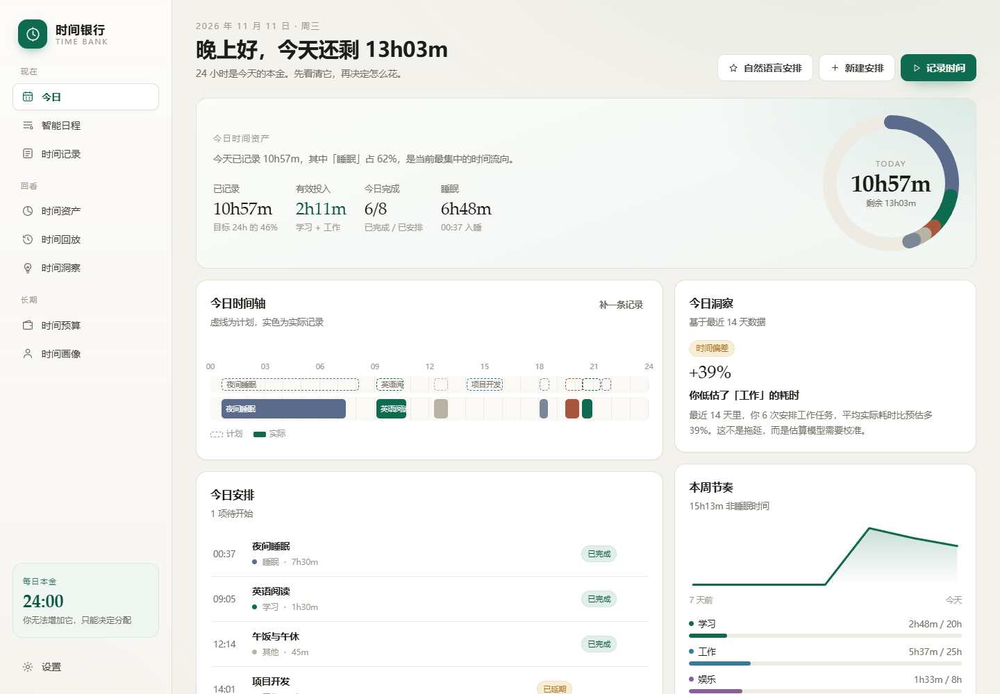
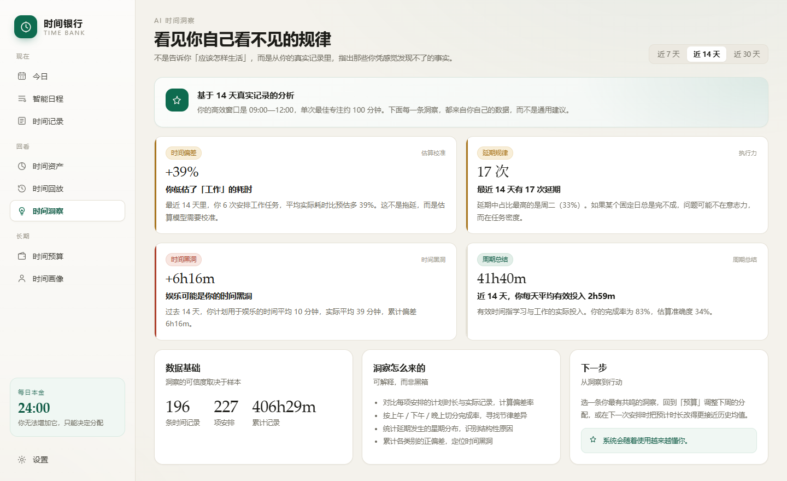
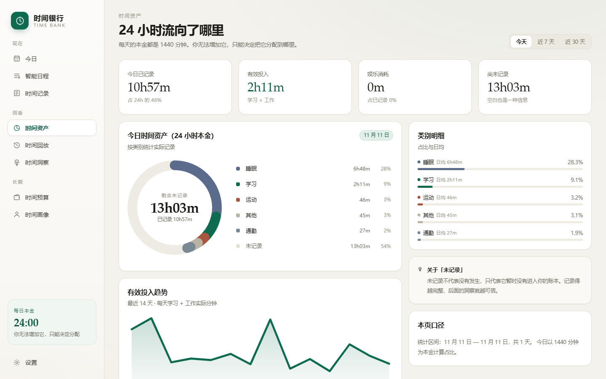
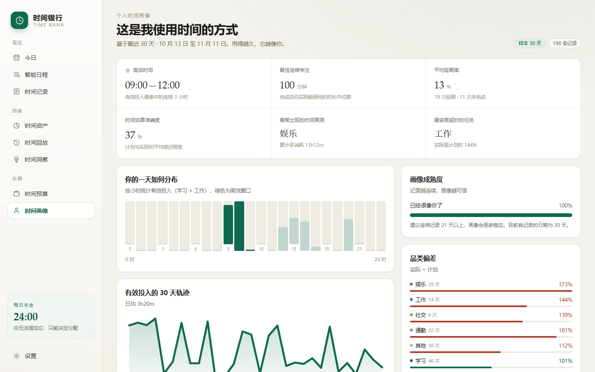
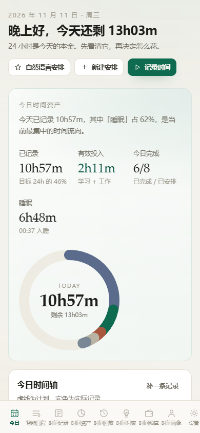

# 时间银行 · Time Bank

> 一款以「时间资产」为核心，通过 AI 帮助用户记录、规划和反思个人时间使用情况的智能日程管理应用。
>
> **不是帮你安排更多事情，而是让你真正看见自己的时间。**

这是《时间银行》项目的**可运行 Web 演示版**，用于验证 MVP 的产品逻辑与交互：日程 → 记录 → 资产 → 洞察 → 画像的完整闭环。纯静态、无需后端，可直接部署到 GitHub Pages。

## 界面预览

| 今日 · 24 小时资产 | 时间洞察 |
| --- | --- |
|  |  |

| 时间资产 | 个人时间画像 |
| --- | --- |
|  |  |

<p align="center">
  
</p>

---

## 快速开始

```bash
npm install
npm run dev        # http://localhost:5173
npm run build      # 产出 dist/
npm run preview    # 预览生产构建
```

环境要求：Node.js 20+。

首次打开会自动生成最近 30 天的演示数据；在「设置」里可以重新生成、清空、导入或导出。

自然语言解析器可以用一个脚本快速验证：

```bash
npx tsx scripts/nlp-check.ts
```

---

## 已实现的功能（对应项目文档 MVP）

| 文档中的功能 | 本演示版的实现 |
| --- | --- |
| ① 智能日程 | 手动新建 + **中文自然语言解析**（`明天下午学习数学两个小时`）→ 日期 / 时间 / 时长 / 类别 |
| ② 实际时间记录 | 一键打卡、手动补录、关联计划、计划 vs 实际偏差对比 |
| ③ 时间资产 | 24 小时本金环形图、类别占比、日均、7/30 天切换 |
| ④ AI 每日 / 每周洞察 | 时间偏差、效率节律、延期规律、时间黑洞、周期总结（可解释的本地规则引擎） |
| ⑤ 个人时间画像 | 高效时间窗、最佳专注时长、延期率、估算准确度、黑洞品类、30 天轨迹 |

超出 MVP 的加分项：

- **时间回放**：一天的计划 / 实际双轨时间轴 + 偏差明细 + 自动总结
- **时间预算与透支**：按周分配预算，实时显示已用 / 剩余 / 透支，可手动调整
- **计划 vs 实际**可视化对比
- 移动端适配（底部导航）

---

## 技术栈

| 层级 | 选型 | 说明 |
| --- | --- | --- |
| 前端 | React 19 + Vite 7 + TypeScript | 纯静态、零运行时依赖 |
| 图表 | 手写 SVG 组件 | 环形图 / 折线 / 条形 / 24 小时热力 |
| 状态 | React Context + useReducer 思路 | 全局 store，localStorage 持久化 |
| AI | 本地规则引擎 | 无需 API Key、离线可用；正式版可替换为 LLM API |
| 部署 | GitHub Actions → GitHub Pages | 推送即构建发布 |

> 文档中正式版规划为 **Flutter + Supabase + Riverpod**。本演示版用 Web 实现是为了在没有 Flutter SDK 的环境中也能直接运行、演示与部署，数据模型与业务逻辑保持同构，后续迁移到 Flutter 时可直接复用实体设计与洞察算法。

---

## 部署到 GitHub Pages

仓库已内置 `.github/workflows/deploy.yml`，**推送 main 分支就会自动构建并发布**。

### 步骤

1. 在 GitHub 新建一个空仓库（例如 `time-bank-app`）。
2. 关联远程仓库并推送：

   ```bash
   git remote add origin https://github.com/<你的用户名>/<仓库名>.git
   git push -u origin main
   ```

3. 打开仓库的 **Settings → Pages**，在 **Build and deployment → Source** 选择 **GitHub Actions**。
4. 进入 **Actions** 标签，等待 `Deploy to GitHub Pages` 工作流跑完（约 1 分钟）。
5. 访问 `https://<你的用户名>.github.io/<仓库名>/` 即可。

### 需要额外配置吗？

**不需要。** `vite.config.ts` 里已经设置：

```ts
base: './'
```

所有资源都用相对路径，因此无论部署在 `https://user.github.io/` 根路径还是 `https://user.github.io/任意仓库名/` 子路径下都能正常加载，不需要为仓库名改配置。

页面切换使用 `#/today`、`#/insights` 这样的 hash 路由，刷新不会 404，也不需要额外的 404 重写规则。

### 如果部署不成功

- 确认 Settings → Pages 的 Source 已选择 **GitHub Actions**（不是 Deploy from a branch）。
- 确认仓库的 Actions 权限：Settings → Actions → General → Workflow permissions 至少为 *Read and write*（默认即可）。
- 首次启用 Pages 后重新运行一次工作流（Actions → 对应 run → Re-run all jobs）。
- 免费账号的 Pages 需要仓库为 **Public**（Private 仓库发布 Pages 需要付费计划）。

### 自定义域名（可选）

在仓库根目录添加 `CNAME` 文件，内容为你的域名，然后在域名服务商处配置 CNAME 记录指向 `<用户名>.github.io`。

---

## 目录结构

```
src/
├─ components/         # UI、图表、时间轴、表单
│  ├─ ui.tsx           # Card / Stat / Tag / Modal / Field 等基础元件
│  ├─ charts.tsx       # 环形图、折线、24 小时分布、对比条
│  ├─ timeline.tsx     # 计划 / 实际双轨时间轴
│  ├─ forms.tsx        # 任务与记录表单、自然语言快捷录入
│  └─ icons.tsx
├─ data/
│  ├─ categories.ts    # 五类时间资产的配色与关键词
│  └─ seed.ts          # 30 天确定性演示数据
├─ lib/
│  ├─ date.ts          # 本地时区日期与时长工具
│  ├─ analytics.ts     # 聚合、偏差、完成率、节律、画像指标
│  ├─ insights.ts      # 洞察生成与规则
│  ├─ nlp.ts           # 中文自然语言日程解析
│  └─ store.tsx        # 全局状态 + localStorage
├─ pages/              # 今日 / 日程 / 记录 / 资产 / 回放 / 洞察 / 预算 / 画像 / 设置
├─ App.tsx             # 布局与 hash 路由
└─ styles.css          # 设计系统
```

---

## 数据说明

- 所有数据保存在浏览器 `localStorage`（key: `time-bank:v1`），不会上传到任何服务器。
- 演示数据是**确定性生成**的（固定随机种子），因此每次「重新生成」看到的洞察一致，便于演示与截图。
- 数据可导出为 JSON 备份，并在其他设备导入。

---

## 后续路线

- [ ] 迁移到 Flutter + Supabase（正式 App）
- [ ] 接入 LLM API，替换规则引擎生成更自然的洞察文案
- [ ] 时间预算自动调整与透支预警
- [ ] 智能排程（结合历史耗时与高效时间窗）
- [ ] 屏幕使用时间等自动采集

---

## License

MIT © 2026 MON3TR
